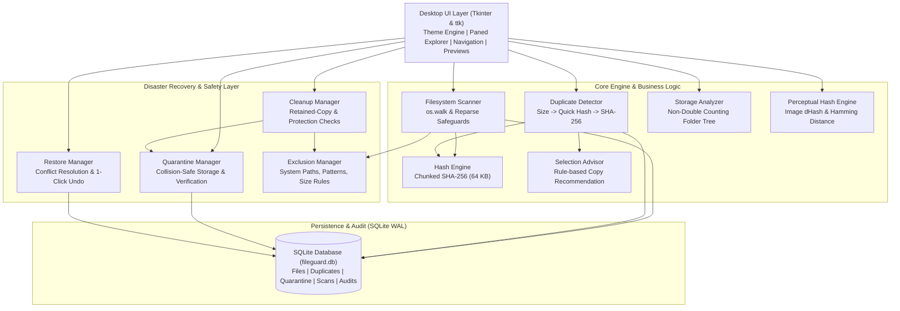
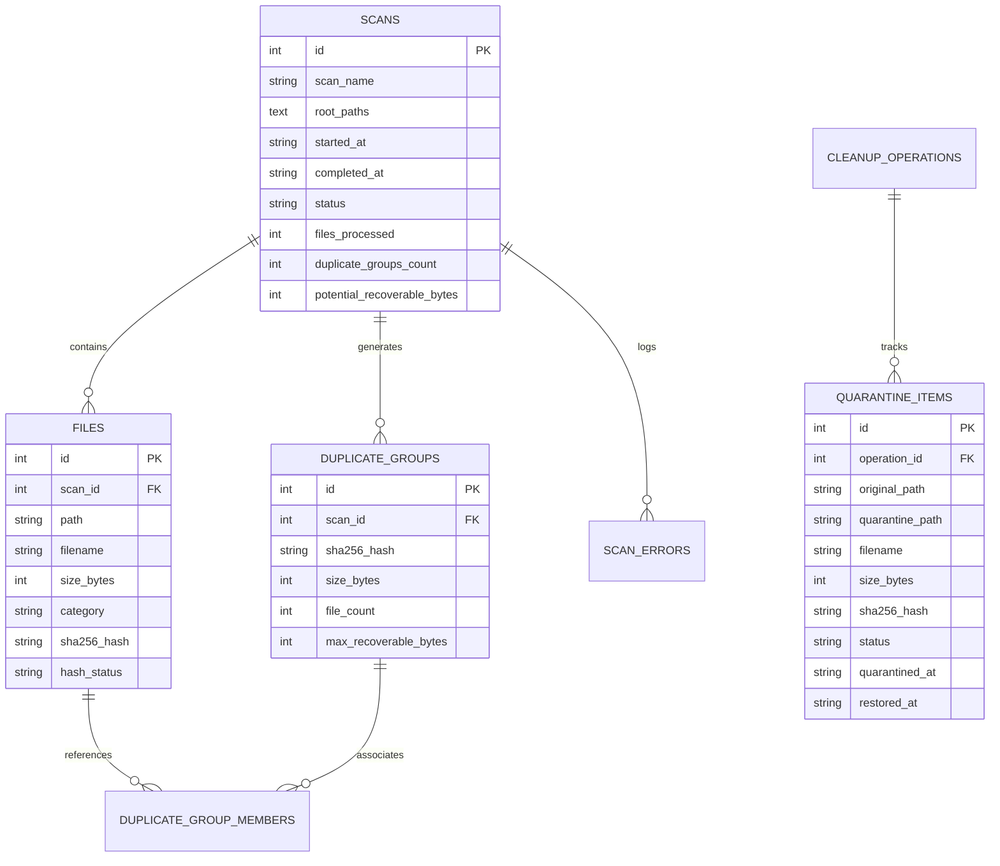

# FileGuard — Architecture & System Design

FileGuard is built on a clean layered desktop architecture separating core filesystem operations, cryptographic engines, and persistence layers from the Tkinter/ttk user interface.

---

## 1. High-Level Architecture Diagram



---

## 2. Multi-Stage Exact Duplicate Detection Algorithm

Calculating full SHA-256 fingerprints on every file in a 100 GB drive would bottleneck disk I/O. FileGuard employs a 4-stage deterministic funnel:

```text
[All Discovered Files]
       │
       ▼ (Stage 1: Size Clustering)
Group files by exact size in bytes.
Discard all size buckets with count < 2 (unique sizes cannot be duplicates).
       │
       ▼ (Stage 2: Partial Quick Hash for files >= 32 KB)
Read only first 4 KB chunk and compute partial SHA-256.
Group by (size, partial_hash). Discard buckets with count < 2.
       │
       ▼ (Stage 3: Full Chunked SHA-256 Hashing)
For candidate collisions, read entire file in 64 KB memory-safe chunks.
Compute standard 256-bit cryptographic digest. Re-verify st_size and st_mtime.
       │
       ▼ (Stage 4: Verification & Savings Calculation)
Group by (size, sha256). Form DuplicateGroups where file_count >= 2.
Theoretical Recoverable Space = (N - 1) * S
Pass group to SelectionAdvisor to suggest canonical retained copy.
```

---

## 3. Database Entity-Relationship Schema

FileGuard utilizes SQLite in WAL (Write-Ahead Logging) mode with foreign keys enabled:


